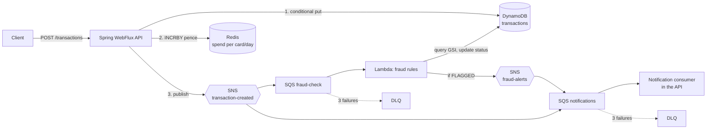

# card-txn-platform

A small, event-driven **card transaction and fraud alert** platform built with **Java 21, Spring WebFlux and AWS**.

A card swipe hits a reactive REST API. The transaction is stored in DynamoDB, today's spend is counted in Redis, and an event goes out on SNS. SNS fans the event out to two SQS queues: a Java Lambda runs fraud rules, and a notification consumer tells the customer about the payment (and about any fraud alert).

| Layer | Tech |
|---|---|
| API | Java 21, Spring Boot 4, **Spring WebFlux** (Project Reactor), Bean Validation, Actuator |
| Data | **DynamoDB** (conditional writes, GSI), **Redis** (reactive Lettuce) |
| Messaging | **SNS** fan-out, **SQS** with dead-letter queues |
| Compute | **AWS Lambda** (Java 21) with partial batch failures |
| Infrastructure | **AWS CDK in Java**: VPC + NAT gateway, ElastiCache, ECS Fargate + ALB, IAM least privilege |
| Testing | JUnit 5, Mockito, Reactor `StepVerifier`, `WebTestClient`, **Testcontainers** |
| Local AWS | [Moto](https://github.com/getmoto/moto) (free, open-source AWS emulator) + Redis in Docker Compose |

## Architecture



## The workflow, step by step

1. **`POST /transactions`** arrives. WebFlux handles it on an event-loop thread. Nothing in the request path blocks: every AWS call uses the async SDK (`CompletableFuture` wrapped in `Mono`).
2. **Validate.** Card is 16 digits, amount is positive with at most 2 decimals, currency is ISO 4217. Bad input gets a `400` with an RFC 9457 problem-details body.
3. **Save to DynamoDB, idempotently.** The client's `idempotencyKey` is the `txnId`, and the write uses `attribute_not_exists(txnId)`. If a client retries after a timeout, the duplicate is detected, the original is returned with `200`, and nothing is charged or published twice. A new transaction gets `202 Accepted` with status `PENDING`.
4. **Count spend in Redis.** `INCRBY spend:{cardId}:{date}` in **pence** (never floating point for money), with a 2-day TTL. `GET /cards/{id}/spend/today` reads it in microseconds.
5. **Publish `TransactionCreated` to SNS.** The API returns now: the fraud check is asynchronous, so the customer isn't kept waiting.
6. **SNS fans out** to the `fraud-check` and `notifications` queues (raw message delivery, so consumers get the event JSON directly). Each consumer scales, retries and fails on its own.
7. **Fraud Lambda** (batches of up to 10):
   - counts swipes on the card in the last 60s with a **GSI query** (`cardId` + `createdAt`)
   - applies the rules: **amount > £1,000** or **3+ swipes in 60s**
   - moves the transaction `PENDING → APPROVED | FLAGGED` with a **conditional update**, so a redelivered message can't flip a decision
   - if flagged, publishes a `FraudAlert` to the `fraud-alerts` topic
   - reports **partial batch failures**, so only failed messages are retried. After 3 failures a message goes to the **DLQ**.
8. **Notification consumer** (a reactive SQS long-poll loop inside the API) logs the payment notification and any fraud alert. It deletes a message only after handling it successfully.

## Run it locally

You need Java 21, Maven and Docker. On macOS:

```bash
brew install openjdk@21 maven colima docker docker-compose
colima start
```

Start everything (Moto + Redis in Docker, the API, and the fraud "Lambda"):

```bash
scripts/run-local.sh
```

In another terminal, run the demo scenarios:

```bash
scripts/demo.sh
```

You'll see, for example:

```
{"txnId":"...-b","card":"**** 8888","amount":1500.00,...,"status":"FLAGGED","fraudReason":"HIGH_AMOUNT: over 1000.00",...}
{"txnId":"...-v3","card":"**** 7777","amount":9.99,...,"status":"FLAGGED","fraudReason":"VELOCITY: 3 swipes in 60s",...}
```

And in the API log:

```
NOTIFY  **** 8888: payment of 1500.00 GBP at Apple Store
ALERT   **** 8888: transaction ...-b flagged (HIGH_AMOUNT: over 1000.00). Was this you?
```

> **Why Moto and not LocalStack?** LocalStack's image now needs an auth token. Moto is free, emulates DynamoDB, SNS and SQS (including SNS → SQS delivery), and runs on port 4566 here (macOS AirPlay already uses 5000).
>
> **How does the Lambda run locally?** In AWS, Lambda's SQS event source mapping polls the queue and invokes `FraudHandler`. Locally, `LocalSqsPoller` does the same job and calls the **same handler class**, so the code you test is the code you deploy.

### Manual requests

```bash
curl -i -X POST localhost:8080/transactions -H 'Content-Type: application/json' -d '{
  "idempotencyKey": "order-42",
  "cardId": "4000123412341234",
  "amount": 25.50,
  "currency": "GBP",
  "merchant": "Tesco"
}'

curl localhost:8080/transactions/order-42
curl localhost:8080/cards/4000123412341234/spend/today
```

| Endpoint | Result |
|---|---|
| `POST /transactions` | `202` new (status `PENDING`), `200` idempotent replay, `400` invalid |
| `GET /transactions/{txnId}` | `200` with current status, `404` if unknown |
| `GET /cards/{cardId}/spend/today` | today's total from Redis |
| `GET /actuator/health` | health check (used by the ALB in AWS) |

## Tests

```bash
mvn verify
```

- `TransactionServiceTest`: the reactive chain with `StepVerifier` (new, duplicate, SNS failure)
- `TransactionControllerTest`: `@WebFluxTest` + `WebTestClient` (202, 200, 400, 404, card masking)
- `TransactionFlowIT`: **Testcontainers** starts Moto and Redis, then proves the API writes to DynamoDB, counts spend once even when replayed, and that SNS delivers exactly one event to the fraud queue
- `FraudRulesTest`: the fraud rules, including boundaries

## Deploy to AWS (optional)

The CDK app in `infra/` (Java) creates the whole stack: DynamoDB with a GSI and point-in-time recovery, two SNS topics, four SQS queues (two DLQs), the Java 21 Lambda with its SQS trigger, a VPC with public and private subnets and **one NAT gateway**, **ElastiCache Redis** reachable only from the API's security group, and the API on **ECS Fargate behind an ALB**, with least-privilege IAM grants.

```bash
mvn -B package -DskipTests       # builds the API jar and the Lambda fat jar
cd infra
cdk bootstrap                    # once per account/region
cdk deploy
cdk destroy                      # when you're done
```

> ⚠️ **Cost:** the NAT gateway, ALB, Fargate task and ElastiCache node bill **by the hour** even when idle (roughly £2–3/day together). DynamoDB, SNS, SQS and Lambda cost pennies at demo volume. Run `cdk destroy` after trying it.

## Design decisions (and the trade-offs)

- **Idempotency key as partition key + conditional write.** It's the simplest way to make retries safe without a separate idempotency table. Trade-off: a replay with a different payload returns the original; a production API would also compare a payload hash and return `422`.
- **202 + async fraud check.** It keeps API latency low and decouples fraud from the write path. Trade-off: the client sees `PENDING` first. Real card authorisation has a hard latency budget and runs a fast synchronous risk score, with deeper checks async.
- **SNS → SQS fan-out instead of one queue.** Each consumer gets its own queue, retries and DLQ, so a slow notification service can't delay fraud checks.
- **At-least-once everywhere.** SQS can deliver twice, so every consumer is idempotent: the Lambda's conditional `PENDING → X` update means a duplicate can't change a decision. If the alert publish failed after the status update, the redelivered message re-publishes the alert rather than losing it. Duplicate alerts are acceptable; lost ones are not.
- **Money as `BigDecimal` and pence.** JSON numbers are parsed as `BigDecimal` (scale kept), and Redis counts integer pence. There's no `double` anywhere money flows.
- **Card numbers masked** in every response and log line (`**** 1234`).
- **Sync SDK + URL-connection client in the Lambda.** It starts fast, has few dependencies, and the clients are created once per container and reused across invocations.
- **One NAT gateway.** Cheap for a demo. Production would use one per AZ for resilience, or VPC endpoints for DynamoDB/SNS/SQS to cut NAT data costs.

## What I'd add next

- Transactional outbox (DynamoDB Streams → EventBridge) so the save and the publish can't diverge
- Lambda Powertools (structured logs, idempotency utility, metrics) and X-Ray tracing
- DynamoDB global tables for multi-region DR
- A spending-limit check against the Redis total before accepting a payment
- `cdk-nag` security checks in CI and GitHub OIDC deploys

## Project layout

```
card-txn-platform/
├── api/            Spring Boot WebFlux service (controller, service, DynamoDB, Redis, SNS, SQS consumer)
├── fraud-lambda/   Java Lambda handler + fraud rules (+ LocalSqsPoller for local runs)
├── infra/          AWS CDK app in Java
├── scripts/        run-local.sh, demo.sh
└── docker-compose.yml   Moto + Redis
```

## License

MIT
